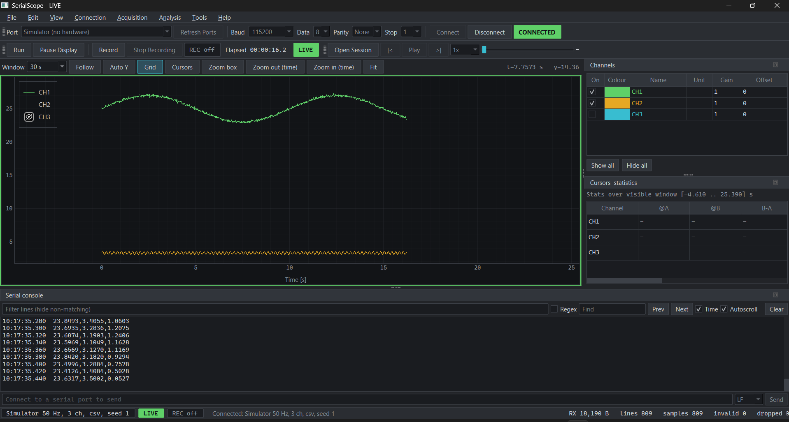

# SerialScope

SerialScope is a desktop serial monitor I built for working with microcontrollers. It lets you view serial output as live graphs instead of just reading numbers in a terminal. You can also record data, inspect it later, and test the application using its built-in simulator without connecting a board.



## Try SerialScope

**[Download SerialScope for Windows](https://github.com/threatsentinels/SerialScope/releases/tag/main)**

If you just want to try it, download the `.exe` and open it. You don't need to install Python.

To see how it works without connecting a microcontroller:

1. Open SerialScope.
2. Select `Simulator` from the port list.
3. Click `Connect`.

Windows might show a SmartScreen warning because the executable isn't code-signed.

## What can it do?

Here are some things I've implemented in SerialScope:

- **Live plotting:** Plot multiple serial channels together, adjust the time window, zoom, pan and use autoscaling.
- **Serial console:** View the original incoming text, search through it, filter messages using text or regular expressions, and send data back to the board.
- **Different data formats:** Read comma-separated values, key-value pairs and JSON objects. Lines that cannot be parsed are still available in the console.
- **Recording and playback:** Save a session, open it later, replay it at different speeds (0.25x–50x), and export the data as CSV.
- **Measurements:** Use two cursors to measure time differences and view minimum, maximum, average and peak-to-peak values for each channel.
- **Simulator:** Generate sample data with noise, spikes and malformed lines. This makes it possible to explore the application without any hardware.
- **Trigger and spectrum:** Set a threshold trigger with pre/post capture and inspect signals using the spectrum view.

## Running from source

SerialScope currently requires Python 3.13 (64-bit).

On Windows, open PowerShell in the project directory:

```powershell
py -3.13 -m venv .venv
.\.venv\Scripts\Activate.ps1
pip install -r requirements.txt
python main.py
```

If PowerShell doesn't allow the activation script to run, use:

```powershell
Set-ExecutionPolicy -Scope Process -ExecutionPolicy Bypass
```

Then activate the environment again.

## Connecting a microcontroller

SerialScope works with line-based serial output. Before connecting, close other programs that might already be using the same serial port.

1. Connect your board to the computer.
2. Open SerialScope and press Refresh.
3. Select the board's serial port.
4. Configure the baud rate and other serial settings.
5. Press Connect.

Your microcontroller should send one data record per line. LF, CRLF and CR line endings are supported.

These are the formats SerialScope can currently read:

| Format | Example |
|---|---|
| Comma-separated values | `12.4,25.1,0.8` |
| Key-value pairs | `temperature=25.1,humidity=60.2` |
| JSON objects | `{"t":25.1,"h":60.2}` |

For comma-separated values, channels are automatically named `CH1`, `CH2`, etc. For key-value pairs and JSON, the field names are used as channel names.

You can also send commands to your board through the console's send box.

### Keyboard shortcuts

Some shortcuts I use frequently:

| Shortcut | Action |
|---|---|
| `Ctrl + K` | Connect |
| `F6` | Pause display |
| `Ctrl + R` | Start recording |
| `F9` | Toggle cursors |
| `Ctrl + O` | Open a recorded session |

The complete shortcut list is available under Help → Keyboard Shortcuts.

## A little about how it works

One thing I wanted to avoid was letting the plotting interface interfere with serial data collection.

The serial reader runs in a separate thread. It reads incoming lines, timestamps them using a monotonic clock, parses the values and sends batches to the GUI through a bounded queue. This means the GUI doesn't have to read directly from the serial port.

The display and data collection are also separate. When the display is paused, SerialScope keeps collecting and recording incoming data. It simply stops updating the visible plot.

For live plotting, I use a bounded ring buffer rather than keeping every incoming sample in memory. Recordings are handled separately and written to disk in JSON Lines format (`.sscope`). The plot also uses min/max decimation when drawing large datasets, so short spikes aren't simply lost when displaying a large time window.

There are a few trade-offs. Timestamps represent when data reaches the computer, not when the microcontroller generated it. The application also tracks dropped or rejected data through status counters rather than silently ignoring it.

## Building the executable

The Windows executable can be built using the included PowerShell script.

Install the development dependencies:

```powershell
pip install -r requirements-dev.txt
```

Then run:

```powershell
.\build.ps1
```

The script runs the tests before building `dist\SerialScope.exe`.

For debugging startup problems, you can build with the console enabled:

```powershell
.\build.ps1 -Console
```

To run the tests separately:

```powershell
python -m unittest discover -s tests
```

