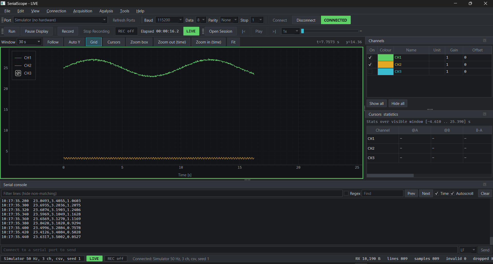

# SerialScope

An oscilloscope-style serial monitor for embedded work: plot the numbers your microcontroller prints, watch the raw console, record sessions and replay them later, with or without hardware.




## Try it

**[Download SerialScope.exe (Windows)](https://github.com/threatsentinels/SerialScope/releases/tag/main)**

No Python needed. Double-click, pick **Simulator** in the port box, press **Connect**. The exe is unsigned, so Windows SmartScreen may warn: click **More info**, then **Run anyway**.

## Quick start

From source (Python 3.13, 64-bit, PowerShell):

```powershell
py -3.13 -m venv .venv
.\.venv\Scripts\Activate.ps1
pip install -r requirements.txt
python main.py
```

If PowerShell blocks scripts, run `Set-ExecutionPolicy -Scope Process -ExecutionPolicy Bypass` first.

## Features

- Live multi-channel plot with a time window, follow mode, autoscale, pan and zoom
- Raw serial console with timestamps, text/regex filter, find and a send box
- Parses `12.4,25.1,0.8`, `temperature=25.1,humidity=60.2` and JSON objects; unparseable lines still appear in the console and are counted
- Pause the display while acquisition and recording keep running
- Record straight to disk, reopen the session, replay it in real time at 0.25x to 50x, export CSV
- Cursors A/B with time delta, plus min / max / mean / peak-to-peak per channel
- Built-in simulator (seeded noise, spikes, malformed lines) so you can try everything without a board
- Optional threshold trigger with pre/post capture, and a spectrum view with peak frequency

## Running it with a board

1. Close anything else using the port (Arduino IDE, another terminal).
2. Press Refresh, choose the port, set baud / data bits / parity / stop bits, press Connect.
3. Print one record per line (LF, CRLF or CR).

| Format | Example | Channel names |
|---|---|---|
| Numbers separated by `,` `;` tab or space | `12.4,25.1,0.8` | `CH1`, `CH2`, ... |
| key=value or key:value | `temperature=25.1,humidity=60.2` | the keys |
| JSON object with numeric fields | `{"t":25.1,"h":60.2}` | the field names |

Useful keys: Ctrl+K connect, F6 pause display, Ctrl+R record, F9 cursors, Ctrl+O open session. The full list is under Help > Keyboard Shortcuts.

## How it works

The serial reader runs on its own thread and never touches the UI. It timestamps each line with a monotonic clock, parses it, and hands batches to the GUI through a bounded queue, so a slow plot cannot stall the port. Pausing the display swaps the plot to a snapshot copy; incoming data, recording and triggers carry on underneath.

Nothing is dropped silently. The live buffer is a bounded ring for display only, while recordings stream to disk as JSON Lines (`.sscope`), so they use no extra memory and survive a crash. Anything lost, such as a queue overflow, an over-long line or a channel beyond the 16-channel limit, shows up in the status bar counters. Each redraw decimates only the visible window with min/max buckets, so spikes stay visible at any zoom.

Timestamps are host arrival times, interpolated inside each read chunk, so expect a few milliseconds of jitter rather than device-exact timing.

## Building the .exe

```powershell
pip install -r requirements-dev.txt
.\build.ps1            # runs the tests, then builds dist\SerialScope.exe
.\build.ps1 -Console   # console build for debugging startup problems
```

Tests only: `python -m unittest discover -s tests`

## Known limitations

- Line-based text protocols only (no binary frames)
- Very large session files load fully into memory
- The trigger freezes the display; it does not gate recording
- No app icon and no code signing


See [LICENSE](LICENSE).
